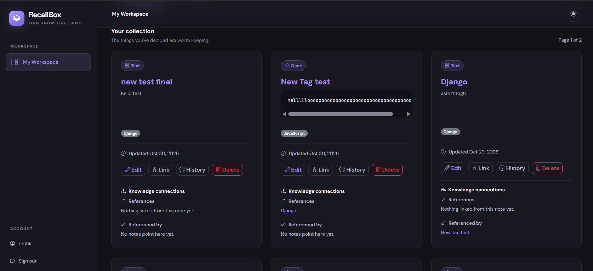

# RecallBox

**A personal knowledge management application built with Django.**

RecallBox helps you capture, organize, connect, and revisit useful information in one place. Whether you're saving programming notes, code snippets, useful links, or learning resources, RecallBox makes your knowledge easier to manage.

## Features

- **User authentication** – Register, log in, and manage your personal workspace.
- **Notes management** – Create, view, edit, archive, and delete notes.
- **Multiple note types** – Organize text notes, code snippets, and links.
- **Tags** – Categorize notes using existing or newly created tags.
- **Search and filtering** – Find notes using search, type, tag, and archive filters.
- **Pagination** – Navigate through notes efficiently.
- **Note connections** – Link related notes and explore their relationships.
- **Revision history** – View previous versions of notes and restore them.
- **Ownership and permissions** – Users can access and manage only their own notes.
- **Responsive interface** – Designed for desktop and mobile screens.
- **Dark and light themes** – Switch between two interface themes.

## Screenshots

### Home Dashboard


### Light Mode


### Create Note


### Note Linking


### Note Detail


### Note Revision History


### Notes Overview



## Technology Stack

- **Backend:** Python, Django
- **Database:** SQLite (development)
- **Frontend:** HTML, CSS, JavaScript, Bootstrap
- **Version control:** Git and GitHub

## Getting Started

Follow these instructions to run RecallBox locally.

### 1. Clone the repository

```bash
git clone https://github.com/rhutik123/RecallBox.git
cd RecallBox
```

### 2. Create a virtual environment

```bash
python -m venv .venv
```

### 3. Activate the virtual environment

**Windows (Command Prompt):**

```bash
.venv\Scripts\activate
```

**Windows (Git Bash):**

```bash
source .venv/Scripts/activate
```

### 4. Install dependencies

```bash
python -m pip install -r requirements.txt
```

### 5. Apply database migrations

```bash
python manage.py migrate
```

### 6. Start the development server

```bash
python manage.py runserver
```

Open your browser and visit:

http://127.0.0.1:8000/

## Running Tests

Run the complete Django test suite:

```bash
python manage.py test
```

Run Django's system checks:

```bash
python manage.py check
```

## Project Goals

RecallBox was developed as a practical Django learning and portfolio project.

The project focuses on:

- Building a structured Django application.
- Understanding models, relationships, and database migrations.
- Implementing authentication and object-level permissions.
- Working with Django forms, views, and templates.
- Writing automated tests.
- Building a responsive and polished user interface.

## Future Improvements

Potential future enhancements include:

- AI-powered note summaries.
- Knowledge graph visualization.
- Production deployment and further performance improvements.

## License

This project is currently intended as a personal learning and portfolio project.