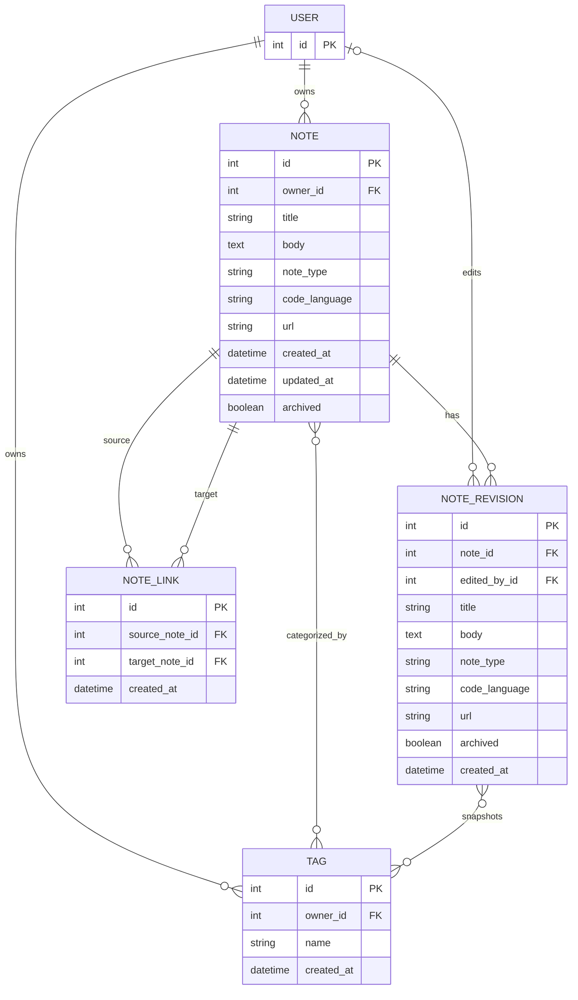

# RecallBox Database Design

This document explains the database structure and model relationships used in RecallBox.

## 1. Entity Relationship Diagram

**Note:** `USER` represents Django's configured user model (`AUTH_USER_MODEL`). Django automatically creates intermediate tables for the many-to-many relationships.

## 2. Models Overview

### Note

The central model of RecallBox. It stores the user's notes.

Important fields:
- `owner`: Foreign key to the user who owns the note.
- `title` and `body`: Store the note's content.
- `note_type`: Identifies text, code, or link notes.
- `code_language`: Stores the programming language for code notes.
- `url`: Stores the external URL for link notes.
- `tags`: Many-to-many relationship with Tag.
- `archived`: Indicates whether the note is archived.
- `created_at` and `updated_at`: Track note timestamps.

Notes are ordered by most recently updated first.

### Tag

Stores categories used to organize notes.

Important fields:
- `owner`: Foreign key to the user who created the tag.
- `name`: Tag name.
- `created_at`: Creation timestamp.

A tag can be associated with multiple notes. Tag names are case-insensitively unique for each owner.

### NoteLink

Connects related notes.

Important fields:
- `source_note`: The note from which the connection starts.
- `target_note`: The note being connected.
- `created_at`: Connection creation timestamp.

Both foreign keys reference Note.

Database constraints prevent duplicate directional links and self-links. Model validation also prevents linking notes owned by different users.

### NoteRevision

Stores snapshots of previous note versions.

Important fields:
- `note`: The note associated with the revision.
- `title`, `body`, `note_type`, `code_language`, and `url`: Snapshot of note content.
- `tags`: Many-to-many relationship with Tag.
- `archived`: Snapshot of the archived state.
- `edited_by`: Optional reference to the user who made the edit.
- `created_at`: Revision creation timestamp.

If the user referenced by `edited_by` is deleted, the revision is retained and the reference becomes NULL.

## 3. Relationship Summary

| Relationship | Type |
|---|---|
| User → Note | One-to-many |
| User → Tag | One-to-many |
| Note ↔ Tag | Many-to-many |
| Note → NoteRevision | One-to-many |
| NoteRevision ↔ Tag | Many-to-many |
| User → NoteRevision | Optional one-to-many |
| Note → NoteLink (source) | One-to-many |
| Note → NoteLink (target) | One-to-many |

## 4. Database Design Decisions

### User ownership

Notes and tags belong to individual users. This supports data isolation between users.

### Many-to-many tags

A note can have multiple tags, and a tag can categorize multiple notes. Django manages the intermediate database table automatically.

### Revision history

Instead of overwriting the previous content permanently, RecallBox stores snapshots in NoteRevision. This makes it possible to inspect and restore previous versions.

### Note connections

NoteLink uses two foreign keys to Note because every connection needs a starting note and a destination note.

### Database constraints

RecallBox uses database constraints to protect data integrity:
- Tag names are unique per owner, ignoring letter case.
- Duplicate directional note links are prevented.
- A note cannot link to itself.

## 5. Django Models

The model definitions are available in:

`notes/models.py`